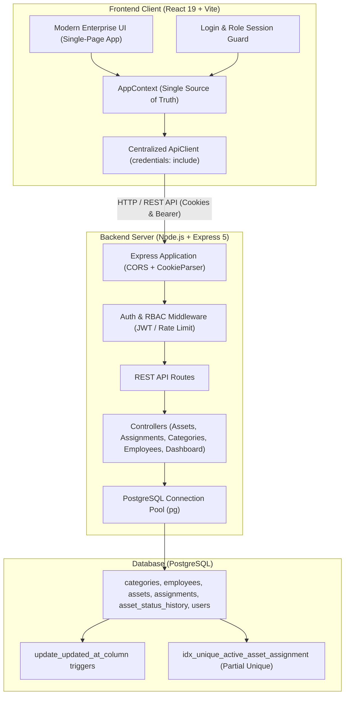

# IT Asset & Inventory Management System

An enterprise-grade, full-stack IT Asset and Inventory Management application designed for tracking hardware lifecycles, employee equipment allocations, custodianship histories, categorized inventory, and analytics.

Built with **React 19**, **Vite**, **Express**, and **PostgreSQL**.

---

## 1. System Architecture



---

## 2. Features Implemented

- **Enterprise Dashboard & Real-Time Analytics**:
  - Authoritative database-backed KPI counters (`totalAssets`, `availableCount`, `assignedCount`, `inRepairCount`, `disposedCount`, `totalInventoryValue`).
  - True status distribution chart and category equipment breakdown.
  - Audit activity stream sourced directly from `asset_status_history`.
  - Automatic fallback to offline cached data if the database server is unreachable.
- **Asset Inventory Management**:
  - Paginated asset browsing with full-text search across code, brand, model, and serial number.
  - Multi-criteria filtering by asset status, category, and department.
  - Unique asset codes and serial numbers enforced at both application and database levels.
- **Asset Lifecycle Management**:
  - Enforced 6-state lifecycle model: `In Stock`, `Assigned`, `In Use`, `In Repair`, `Returned`, and `Disposed`.
  - Concurrency-safe state transitions with required transition reasons and actor tracking.
  - Protection against invalid transitions: Disposed/In Repair assets cannot be assigned; active assignments block disposal or premature stock release.
- **Equipment Assignment Workflow**:
  - Assign eligible hardware to active personnel with assigned date and expected return date.
  - Return workflow with return dates and automatic status updates.
  - Database-enforced partial unique index (`idx_unique_active_asset_assignment`) preventing duplicate active assignments for any asset.
- **Employee & Custodian Directory**:
  - Personnel registry with unique employee codes and emails.
  - Computed active equipment count per employee.
  - Safe deletion protection preventing removal of employees with active custody records.
- **Category & Classification Hierarchy**:
  - Hardware classifications with unique names and derived asset count.
  - Foreign key restriction preventing deletion of categories currently referenced by assets.
- **Authentication & Role-Based Access Control (RBAC)**:
  - Secure password hashing using `bcryptjs` (cost factor 10).
  - Signed JWT session management delivered via secure **`HttpOnly` cookies** (`auth_token`) with SameSite protection against CSRF and XSS.
  - Rate limiting on login attempts to mitigate brute-force attempts.
  - **Admin Role**: Complete CRUD on assets, categories, employees, assignments, and terminal lifecycle transitions.
  - **Staff Role**: Read access to inventory + authorized assignment checkout and return operations.

---

## 3. Technology Stack

| Layer | Technologies |
| :--- | :--- |
| **Frontend** | React 19, React Router v7, Vite 8, Modern CSS Variables, Oxlint |
| **Backend** | Node.js (ES Modules), Express 5, `cookie-parser`, `dotenv` |
| **Database** | PostgreSQL 14+, `pg` (Connection Pooling with health check latency probe) |
| **Security** | `bcryptjs`, `jsonwebtoken` (JWT), HttpOnly Lax/Strict cookies, in-memory rate limiting |
| **Testing** | Node.js native test runner (`node:test`, `node:assert/strict`) |

---

## 4. Prerequisites

- **Node.js**: `v20.0.0` or higher (verified on Node `v24.14.1`)
- **PostgreSQL**: `v14` or higher running locally or remotely
- **npm**: `v9.0.0` or higher

---

## 5. Local Setup & Configuration

### Step 1: Clone and Install Dependencies
```bash
git clone <repository-url>
cd "IT Asset & Inventory Management"
npm install
```

### Step 2: Configure Environment Variables
Copy `.env.example` in the project root to `.env`:
```bash
cp .env.example .env
```

Configure your actual PostgreSQL connection settings in `.env`:
```ini
# Server Port & Environment
PORT=5000
NODE_ENV=development

# JWT Secret & Admin Bootstrapper
JWT_SECRET=your_super_secret_jwt_key_at_least_32_characters_long
ADMIN_EMAIL=admin@company.com
ADMIN_PASSWORD=AdminStrongPassword123!
ADMIN_NAME="System Administrator"

# PostgreSQL Database Configuration
PGHOST=localhost
PGPORT=5432
PGDATABASE=it_asset_management
PGUSER=postgres
PGPASSWORD=your_postgres_password

# Connection Pool Settings
PGMAX_CLIENTS=10
PGIDLE_TIMEOUT_MS=30000
PGCONN_TIMEOUT_MS=5000
PGSSL=false

# Frontend Base URL (Optional: defaults to proxy in dev)
VITE_API_BASE_URL=http://localhost:5000
```

> [!CAUTION]
> Never commit `.env` or real production secrets to version control. The repository `.gitignore` automatically excludes all `.env*` secret files.

---

## 6. Database Setup, Migrations & Seeding

### 1. Create the Database
Using `psql` or PostgreSQL terminal:
```sql
CREATE DATABASE it_asset_management;
```

### 2. Run Idempotent Schema Migrations
```bash
npm run db:migrate
```
*Applies `001_initial_schema.sql` and `002_create_users_table.sql` sequentially within an atomic transaction.*

### 3. Bootstrap Initial Administrator Account
```bash
npm run auth:bootstrap-admin
```
*Generates or updates the primary Admin user (`admin@company.com`) using bcrypt password hashing.*

### 4. (Optional) Seed Sample Inventory Dataset
```bash
npm run db:seed
```
*Seeds enterprise categories, employee personnel, assets, and initial assignments.*

---

## 7. Running the Application

### Start Backend API Server
```bash
npm run server
# Or with automatic reload during development:
npm run server:dev
```
*Backend runs on `http://localhost:5000`.*

### Start Frontend Client
In a separate terminal:
```bash
npm run dev
```
*Frontend runs on `http://localhost:5173`.*

---

## 8. Role-Permission Matrix

| Resource / Route | Admin Role | Staff Role | Unauthenticated |
| :--- | :---: | :---: | :---: |
| `GET /api/health` | Allowed | Allowed | Allowed |
| `POST /api/auth/login` | Allowed | Allowed | Allowed |
| `POST /api/auth/logout` | Allowed | Allowed | Allowed |
| `GET /api/auth/me` | Allowed | Allowed | 401 Unauthorized |
| `GET /api/dashboard/stats` | Allowed | Allowed | 401 Unauthorized |
| `GET /api/categories` | Allowed | Allowed | 401 Unauthorized |
| `POST /api/categories` | Allowed | **403 Forbidden** | 401 Unauthorized |
| `PUT /api/categories/:id` | Allowed | **403 Forbidden** | 401 Unauthorized |
| `DELETE /api/categories/:id` | Allowed | **403 Forbidden** | 401 Unauthorized |
| `GET /api/employees` | Allowed | Allowed | 401 Unauthorized |
| `POST /api/employees` | Allowed | **403 Forbidden** | 401 Unauthorized |
| `PUT /api/employees/:id` | Allowed | **403 Forbidden** | 401 Unauthorized |
| `DELETE /api/employees/:id` | Allowed | **403 Forbidden** | 401 Unauthorized |
| `GET /api/assets` | Allowed | Allowed | 401 Unauthorized |
| `POST /api/assets` | Allowed | **403 Forbidden** | 401 Unauthorized |
| `PUT /api/assets/:id` | Allowed | **403 Forbidden** | 401 Unauthorized |
| `DELETE /api/assets/:id` | Allowed | **403 Forbidden** | 401 Unauthorized |
| `PATCH /api/assets/:id/status` | Allowed | Allowed | 401 Unauthorized |
| `GET /api/assignments` | Allowed | Allowed | 401 Unauthorized |
| `POST /api/assignments` | Allowed | Allowed | 401 Unauthorized |
| `POST /api/assignments/:id/return` | Allowed | Allowed | 401 Unauthorized |

---

## 9. Testing & Code Quality Verification

### Run Backend Integration Tests
```bash
npm run test:api
```
Executes **35 automated integration tests across 12 suites**, covering:
1. Root informational and fallback 404 responses.
2. Pagination, email formatting, and date validation helpers.
3. PostgreSQL error code mapping (23505 unique, 23503 foreign key, 23514 check constraint).
4. Category payload validation and uniqueness rules.
5. Employee mandatory fields, email regex, and status enum validation.
6. Asset required attributes and valid 6-state lifecycle statuses.
7. Assignment asset/employee validation and date sequence integrity.
8. Lifecycle status transition payload checks.
9. Concurrency conflict mapping for partial index `idx_unique_active_asset_assignment`.
10. Authentication endpoints, rate limiting, and password format validation.
11. Dashboard analytics authentication enforcement and endpoint protection.
12. Mutation boundary enforcement (401 unauthenticated, 403 staff forbidden).

> [!NOTE]
> Integration tests that mock pool responses run completely offline and require no live PostgreSQL instance. Full database-dependent test runs verify live queries against the configured test database.

### Run Frontend Linter
```bash
npm run lint
```
*Verified clean with Oxlint (0 warnings, 0 errors).*

### Run Production Build
```bash
npm run build
```
*Generates optimized production assets in `dist/`.*

---

## 10. Production Deployment Guidance

1. **Environment Configuration**:
   - Set `NODE_ENV=production`.
   - Set a high-entropy secret for `JWT_SECRET` (at least 32 characters).
   - Ensure `PGSSL=true` if connecting to managed database services (AWS RDS, Supabase, Neon, GCP Cloud SQL).
2. **Reverse Proxy & HTTPS**:
   - In production, enforce HTTPS so that cookies with `Secure` flags are transmitted safely.
   - Configure reverse proxy (Nginx, Caddy, or Cloudflare) to forward `X-Forwarded-For` and `X-Forwarded-Proto` headers.
3. **Database Migrations on Deploy**:
   - Run `npm run db:migrate` during release or pre-deployment phase.
   - Run `npm run auth:bootstrap-admin` with secure environment variables to seed the production admin user.
4. **Static Frontend Hosting**:
   - Build frontend with `npm run build`. Serve `dist/` via Nginx, Vercel, Netlify, or Express static middleware with fallback routing to `dist/index.html`.

---

## 11. Known Limitations

- **Email Delivery**: Password reset workflows currently operate via administrator resets; SMTP integration is intentionally deferred.
- **Bulk Import / Export**: Data exchange currently operates via JSON REST endpoints; CSV/XLSX bulk import/export is not bundled in this release.
